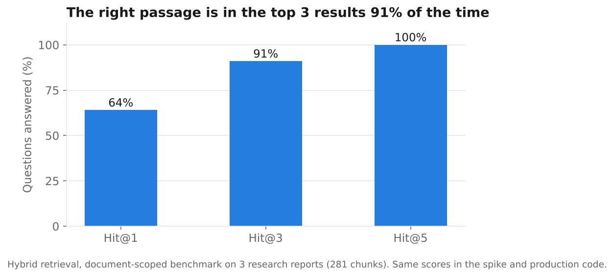
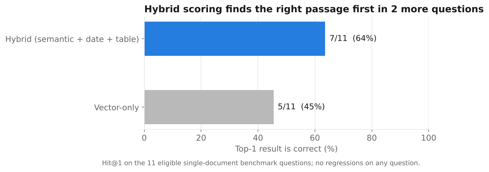
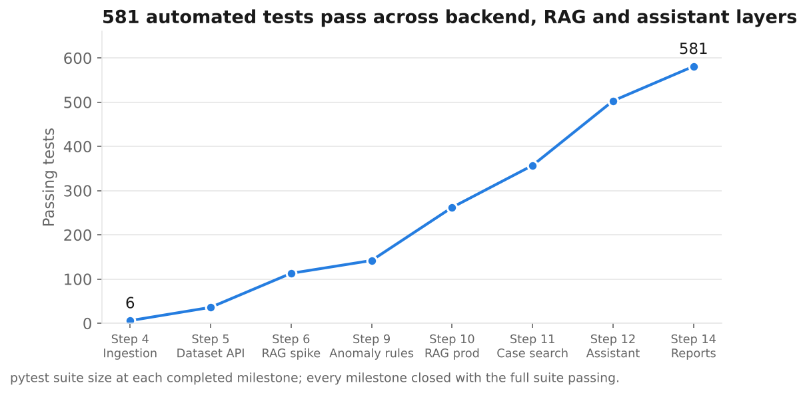
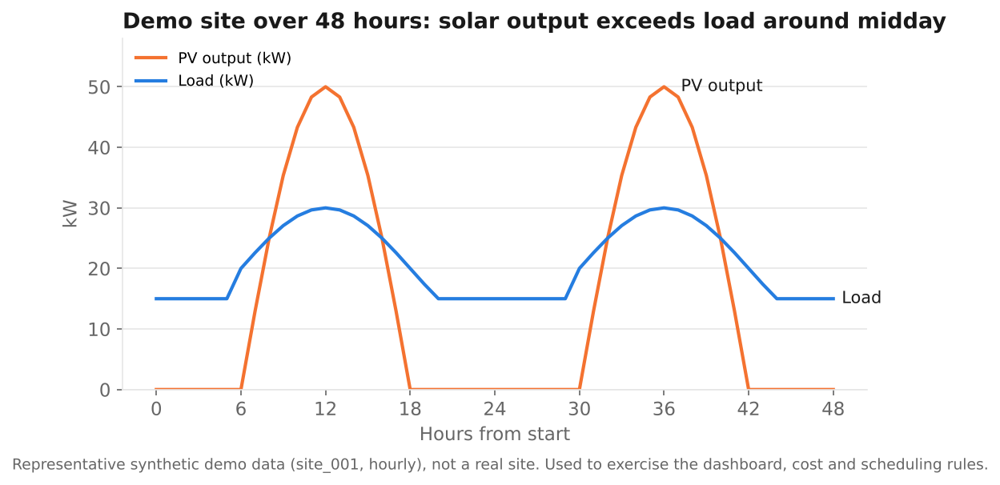
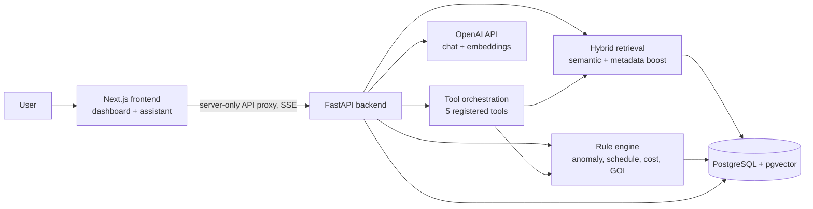

# AI Energy Operations Copilot

An AI copilot for energy operations teams. It combines an operations dashboard with a grounded AI assistant that answers questions from internal documents, imported time-series data and past incident cases, so every answer can be traced back to a source.

It covers solar PV, EMS, battery storage scheduling, anomaly diagnosis, similar-case search, cost estimation and a Green Operations Index, built as a full-stack application with Next.js, FastAPI and PostgreSQL + pgvector.


---

## Highlights

- **Grounded answers only.** The assistant uses internal sources by default (uploaded documents, imported CSV datasets, case records, built-in rules). When the data is insufficient it says so and lists what is missing, instead of guessing.
- **Hybrid RAG retrieval.** Semantic search combined with date and table metadata boosts. On the document benchmark, the right passage is in the top 3 results 91% of the time.
- **Controlled tool use.** The assistant can call 5 registered tools only, with a capability guard and hard limits (3 rounds, 5 calls) per answer.
- **Rule-based decision support.** Anomaly diagnosis, battery scheduling, cost estimation and the Green Operations Index are deterministic and explainable.
- **Tested end to end.** 581 automated tests, CI on every pull request (frontend lint and build, backend pytest against a real PostgreSQL + pgvector service), CodeQL and Dependabot.

---

## Results

### Retrieval quality

Benchmark questions with known ground-truth passages, run against 281 chunks from 3 energy research reports. Production code reproduces the prototype scores question by question, with zero regressions.





| Metric | Result |
|---|---|
| Hit@1 / Hit@3 / Hit@5 (document-scoped) | 64% / 91% / 100% |
| Hit@3 (global, all documents) | 82% |
| Table detection in report PDFs | 14 of 18 tables |
| Re-ingestion of unchanged documents | 0 new embedding calls, 0 duplicate chunks |

### Engineering quality



### Demo data

The dashboard, cost and scheduling features are exercised with a representative synthetic dataset (2 sites, 26 fields, hourly).



---

## Features

| # | Feature | What it does |
|---|---|---|
| 1 | Document knowledge base | Upload PDFs; parsing with OCR fallback, table-aware chunking, idempotent ingestion and blue-green chunk cutover |
| 2 | Time-series ingestion | Validate and import energy CSV data (PV, load, battery, grid, price, weather) with a warning report |
| 3 | Dashboard | PV forecast vs actual, load, battery SOC and temperature, grid import/export, price |
| 4 | Anomaly diagnosis | Rule-based detection, e.g. a battery that should have discharged during peak hours but did not |
| 5 | Similar-case search | Embedding search over past incident records |
| 6 | Battery scheduling | Rule-based charge / discharge / idle / hold suggestions overlaid on the battery chart |
| 7 | Cost estimation | Time-of-use cost, over-contract risk and green-energy waste |
| 8 | Green Operations Index | Composite score of renewable use and battery health |
| 9 | AI assistant | Chat with streaming answers, tool activity panel, regenerate and stop |
| 10 | Analysis report | One-click report that assembles all existing analyses for a dataset |

---

## Architecture



**Assistant tools:** `get_dataset_summary`, `get_dataset_timeseries`, `get_dataset_analysis`, `search_documents`, `search_similar_cases`.

**Database:** plain SQL schema (`database/schema.sql`) for documents and chunks (pgvector), datasets and time series, case records, analysis runs, and conversations.

---

## Tech stack

| Layer | Tools |
|---|---|
| Frontend | Next.js (App Router), React, TypeScript, Tailwind CSS, Recharts |
| Backend | FastAPI, Python 3.11, SQLAlchemy, Pydantic |
| Data | PostgreSQL, pgvector, pandas |
| AI | OpenAI API (chat, embeddings), hybrid retrieval, tool calling, SSE streaming |
| Documents | PyMuPDF, EasyOCR fallback |
| Quality | pytest, ESLint, GitHub Actions CI, CodeQL, Dependabot |
| Infrastructure | Docker Compose |

---

## Quick start

**Requirements:** Docker, Python 3.11 (conda recommended), Node.js, an OpenAI API key.

```bash
# 1. Database (PostgreSQL + pgvector)
cp .env.example .env            # set POSTGRES_PASSWORD, then add OPENAI_API_KEY=...
docker compose up -d
docker exec -i <container_name> psql -U ai_copilot -d ai_copilot < database/schema.sql

# 2. Backend
conda env create -f environment.yml
conda activate AI_Copilot
uvicorn app.main:app --reload --app-dir backend

# 3. Frontend
cd frontend
npm ci
npm run dev
```

Run the tests from the repository root:

```bash
pytest
```

---

## Repository structure

```text
backend/     FastAPI app, services (RAG, rules, assistant), tests
frontend/    Next.js dashboard and assistant UI
database/    SQL schema
data/        synthetic demo dataset, sample case records, demo documents
spike/       RAG feasibility prototype and benchmark reports
docs/        specifications, decisions, plans and validation reports
scripts/     utility scripts
```

Key documents: [MVP spec](docs/MVP_V1_SPEC.md) · [Data schema](docs/DATA_SCHEMA.md) · [Rules](docs/MVP1_RULES.md) · [Technical decisions](docs/DECISIONS.md) · [RAG plan and benchmark](docs/RAG_SPIKE_PLAN.md) · [AI evaluation roadmap](docs/AI_EVALUATION_ROADMAP.md)

---

## Data

- **Time series:** `data/representative_synthetic_energy_operations_timeseries.csv` is synthetic demo data and does not represent any real site.
- **Documents:** the RAG benchmark uses publicly available energy research reports.
- **Scope:** the system does not control real EMS equipment, run real-time grid operations or search the web.

---

## Status

9 of the 10 planned features are complete and verified. The role-based answer mode works in the backend (`role_mode`); its frontend selector is next.

Out of scope for this version: real EMS control, optimization solvers, self-trained forecasting models, multi-agent architecture, and real power-trading integration.
